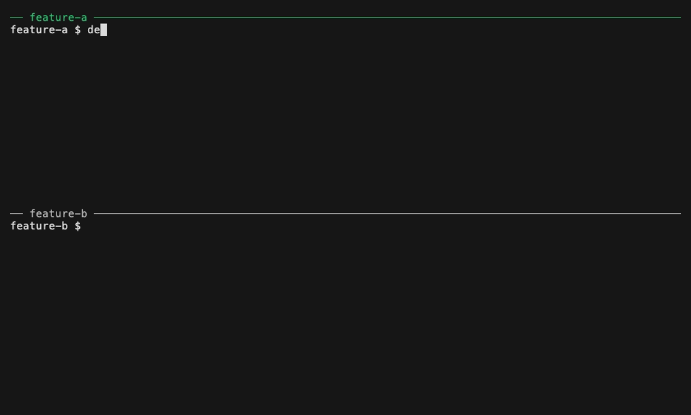

# devtrees

Run your dev stack in every git worktree at once, without port collisions.

Several coding agents can work on one repo in parallel, each in its own git worktree. Each one needs the app running to test its change. With one `process-compose.yaml`, every worktree's stack binds the same ports, so only one can run at a time. You either take turns or hand-edit ports in every checkout.

devtrees is a thin layer over [process-compose](https://github.com/F1bonacc1/process-compose). You mark each service `isolated` (one copy per worktree, with its own ports) or `shared` (one instance for the whole repo, e.g. Postgres). Then `devtrees up` in any worktree starts that worktree's stack. Ports are allocated for you and injected as env vars. The CLI is built to be driven by agents too: it prints JSON, it doesn't block in a non-TTY shell, and its errors have codes.



## Quick start

You need Node.js >= 22, [process-compose](https://f1bonacc1.github.io/process-compose/installation/)
>= v1.122.0 on your `PATH`, and git. The example services below use `python3`
as stand-ins.

```bash
npm install -g devtrees
```

In a git repo (here `my-app`), save this as `devtrees.yaml`:

```yaml
services:
  db:
    tier: shared # one instance for the whole repo
    ports: [DB_PORT]
    command: python3 -m http.server $DB_PORT # stand-in for postgres -p $DB_PORT
  web:
    tier: isolated # one copy per worktree
    ports: [WEB_PORT]
    command: python3 -m http.server $WEB_PORT
```

Commit it, add a second worktree, and bring up a stack in each:

```bash
git add devtrees.yaml
git commit -m "Add devtrees.yaml"
git worktree add ../my-app-b

devtrees up --no-attach
cd ../my-app-b
devtrees up --no-attach
devtrees ls
```

`devtrees ls` lists both worktree instances and the shared one. Your numbers
will differ:

```
ID                 KIND      STATUS   NAMESPACES  PORTS
shared             shared    running  default     DB_PORT=60672
my-app-a7d0a0c6    worktree  running  default     WEB_PORT=60416 DB_PORT=60672
my-app-b-5c6dd959  worktree  running  default     WEB_PORT=51520 DB_PORT=60672
```

Each `web` got its own port; both see the same `DB_PORT`. `devtrees env` prints
this worktree's values as `KEY=value` lines.

Without `--no-attach`, `up` in a terminal opens the process-compose TUI and
returns when you detach. In a non-TTY shell it waits for the services to be
ready and exits.

Stop each worktree's stack, then the shared one:

```bash
devtrees down          # in each worktree
devtrees down --shared # stops the shared instance for every worktree
```

## Concepts

**Tiers.** Each service in `devtrees.yaml` has a `tier`. `isolated` (the
default) runs one copy per worktree, from that worktree's directory. `shared`
runs once for the whole repo, in a single shared instance. The first `up` that
needs the shared instance starts it; a worktree's `down` leaves it running, and
only `down --shared` stops it. Shared services run from the repo's git common
dir, not from a worktree. `devtrees.yaml` uses the process-compose service
schema plus `tier`, and can `extends:` an existing `process-compose.yaml`
instead of repeating it.

**Named ports.** A service lists the ports it needs by env-var name:
`ports: [WEB_PORT]`. devtrees picks a number and injects it under exactly that
name. Isolated ports come from a per-worktree port block that stays the same
across restarts. Shared ports are the same in every worktree, and every
worktree's services get them, so `web` can reach `db` on `$DB_PORT`. devtrees
also injects `DEVTREES_WORKTREE_ID`, for names that must differ per worktree
(sockets, container names).

In a `command`, write `$WEB_PORT`, not `${WEB_PORT}`. process-compose expands
`${WEB_PORT}` when it loads the config, before the port is in the environment,
so it runs empty. `up` warns when it sees one. See
[Referencing ports in a command](docs/reference.md#referencing-ports-in-a-command).

**Namespaces.** A service can set a process-compose `namespace:` to make it
optional. A fresh `devtrees up` starts only services with no namespace;
`-n <namespace>` starts exactly the namespaces it names. See
[Namespaces](docs/reference.md#namespaces) and
[Namespaced shared services](docs/reference.md#namespaced-shared-services).

**State.** devtrees keeps its state (port allocations, derived configs, logs)
in `<git-common-dir>/devtrees/`, inside the git dir, so there is nothing to
add to `.gitignore`. Control sockets live in a short per-user runtime dir. See
[Where devtrees keeps its state](docs/reference.md#where-devtrees-keeps-its-state).

devtrees does not create or remove worktrees; that stays with `git`. If you
remove a worktree whose stack is still running, `devtrees prune` cleans it up.

## Using devtrees from a coding agent

An agent working in a worktree runs this loop:

```bash
devtrees up --json                # start or check the stack, wait for health
eval "$(devtrees env)"            # load this worktree's ports
npm test                          # your tests, against the running stack
devtrees logs web --tail=200      # on failure, read a service's recent logs
devtrees down                     # when done
```

`up` is safe to run before every test run: on a running stack it reloads
changed config and restarts dead services. With `--json`, every command prints
one JSON document on stdout, and failures carry an `error.code` to branch on.

`devtrees init --agents` writes the full instructions into your repo's
`AGENTS.md` (or `CLAUDE.md`). The block it writes, with the failure-handling
table, is in [docs/coding-agents.md](docs/coding-agents.md). The JSON surface
and error codes are in the [reference](docs/reference.md#agent-surface---json).

## Commands

| Command            | What it does                                                                  |
| ------------------ | ----------------------------------------------------------------------------- |
| `devtrees up`      | Bring up this worktree's stack                                                |
| `devtrees down`    | Stop this worktree's stack (`--shared` for the shared instance)               |
| `devtrees restart` | Restart named isolated services in place                                      |
| `devtrees ls`      | List every instance with status, namespaces and ports (`--services`)          |
| `devtrees attach`  | Attach the process-compose TUI to this worktree's instance (`--shared`)       |
| `devtrees prune`   | Reconcile against `git worktree list` and clean up orphaned instances         |
| `devtrees env`     | Print this worktree's injected env (`KEY=value`, or `--json`)                 |
| `devtrees logs`    | Print or stream a service's logs (`--follow`, `--tail=N`, `--since=DUR`)      |
| `devtrees init`    | Write the coding-agent onboarding block into AGENTS.md/CLAUDE.md (`--agents`) |

Every command takes `--json`. `devtrees <cmd> --help` lists its flags,
examples and error codes.

More:

- [Reference](docs/reference.md): every flag, namespaces, the JSON surface, error codes, state locations
- [Using devtrees from a coding agent](docs/coding-agents.md): the onboarding block and failure handling
- [Development](docs/development.md): building, testing, smoke tests, CI
- [Architecture decisions](docs/adr/) and the [domain glossary](CONTEXT.md)
- [The original PRD](https://github.com/pantoninho/devtrees/issues/1)

## License

MIT
